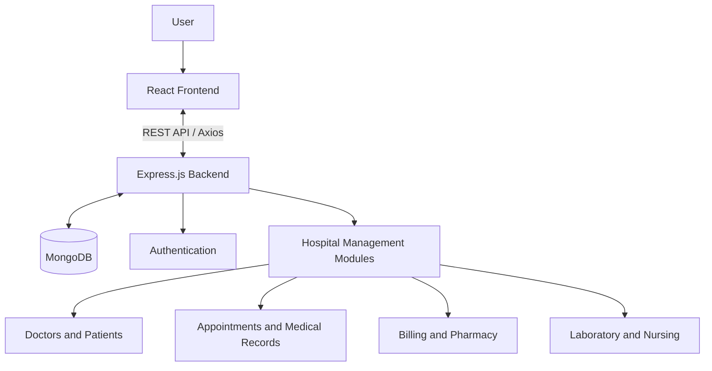

# 🏥 Hospital Management System
A MERN-stack hospital management system, built as a foundation for AI-driven healthcare features (disease prediction and clinical decision support are planned).

A full-stack MERN web application for managing core hospital operations: doctors and patients, appointments and medical records, billing and pharmacy, and laboratory and nursing, with authentication.


## ✨ Features

- 🔐 Authentication
- 👨‍⚕️ Doctor and patient management
- 📅 Appointments and medical records
- 💊 Billing and pharmacy
- 🧪 Laboratory and nursing modules
<!-- [AI] If you have an AI feature, add it here, e.g. - 🤖 Symptom-based department suggestion -->

## 🛠 Tech Stack

| Category | Technologies |
|---|---|
| Frontend | React.js, Vite |
| Backend | Node.js, Express.js |
| Database | MongoDB |
| Language | JavaScript |
| API Communication | Axios, REST API |
| Routing | React Router DOM |
| Configuration | dotenv |
| Middleware | CORS |
| Code Quality | ESLint |
| Version Control | Git and GitHub |

## 🏗 Architecture



## 📁 Project Structure

```
├── backend/     # Express.js API, models, routes
├── frontend/    # React + Vite client
└── README.md
```

## 🚀 Getting Started

### Prerequisites
- Node.js (v18 or later)
- MongoDB (local or Atlas)

### Setup

```bash
git clone https://github.com/Zihad-098/AI-Hospital-Management-System.git
cd AI-Hospital-Management-System
```

**Backend**
```bash
cd backend
npm install
```
Create a `.env` file in `backend/`:
```
PORT=5000
MONGO_URI=your_mongodb_connection_string
JWT_SECRET=your_secret
```
```bash
npm start
```

**Frontend**
```bash
cd frontend
npm install
npm run dev
```

## 🖼 Screenshots


<!-- Add 3-4 screenshots: login, dashboard, appointments, billing -->

## 🗺 Future Improvements
<!-- Add real ones, e.g. role-based access, AI features, deployment -->

## 👨‍💻 Author
**Zihad Hossen** · [GitHub](https://github.com/Zihad-098)
