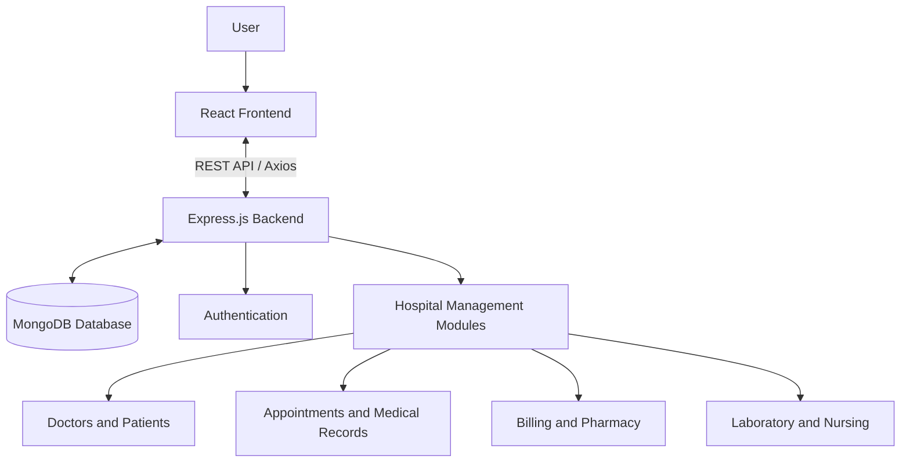

# 🏥 AI Hospital Management System
> A MERN-stack hospital management system, built as a foundation for AI-driven healthcare features (disease prediction and clinical decision support are planned).


## 📌 Project Overview

AI Hospital Management System is a full-stack web application designed to simplify and digitize hospital operations.

The system integrates patient management, doctor management, appointment scheduling, medical records, billing, pharmacy, laboratory services, and nursing activities into a centralized platform.

The main objective is to reduce manual administrative work, improve data accessibility, and support efficient healthcare management.

---

## ✨ Key Features

- **Authentication:** User authentication and account management.
- **Patient Management:** Manage patient information and records.
- **Doctor Management:** Organize doctor information.
- **Appointment Management:** Manage patient appointments.
- **Medical Records:** Maintain patient medical information.
- **Billing Management:** Manage hospital billing information.
- **Room Management:** Manage hospital rooms.
- **Pharmacy Management:** Organize medicine information.
- **Laboratory Management:** Manage laboratory records.
- **Vital Signs Monitoring:** Maintain patient vital signs.
- **Nursing Reports:** Manage nursing documentation.
- **Medication Scheduling:** Organize patient medication schedules.

---

## 🛠️ Technology Stack

| Category | Technologies |
|----------|--------------|
| Frontend | React.js, Vite |
| Backend | Node.js, Express.js |
| Database | MongoDB |
| Programming Language | JavaScript |
| API Communication | Axios, REST API |
| Routing | React Router DOM |
| Configuration | dotenv |
| Middleware | CORS |
| Code Quality | ESLint |
| Version Control | Git & GitHub |

---

## 🏗️ System Architecture



---

## 🔌 API Modules

| API Endpoint | Description |
|--------------|-------------|
| `/api/auth` | User authentication |
| `/api/doctors` | Doctor management |
| `/api/patients` | Patient management |
| `/api/appointments` | Appointment management |
| `/api/medical-records` | Medical records |
| `/api/billing` | Hospital billing |
| `/api/rooms` | Room management |
| `/api/medicines` | Medicine management |
| `/api/laboratory` | Laboratory management |
| `/api/vitals` | Patient vital signs |
| `/api/nursing-reports` | Nursing reports |
| `/api/medications-schedule` | Medication scheduling |

---

## 🚀 Getting Started

### Prerequisites

Make sure the following tools are installed:

- Node.js 24 LTS
- npm
- MongoDB or MongoDB Atlas
- Git

### 1. Clone the Repository

```bash
git clone <your-repository-url>
cd <repository-name>
```

### 2. Backend Setup

```bash
cd backend
npm install
```

Create a `.env` file inside the backend directory.

Example configuration:

```env
PORT=5000
MONGO_URI=your_mongodb_connection_string
JWT_SECRET=your_secret_key
```

Check the backend configuration files for the exact environment variable names.

Start the backend server:

```bash
node server.js
```

Example backend URL:

```text
http://localhost:5000
```

### 3. Frontend Setup

Open another terminal from the project root:

```bash
cd frontend
npm install
npm run dev
```

Open the application in your browser:

```text
http://localhost:5173
```

### 4. Production Build

```bash
cd frontend
npm run build
```

---

## 🔄 Application Workflow

1. Users access the hospital management platform.
2. Authentication requests are processed by the backend.
3. Users access the required hospital management modules.
4. The frontend communicates with the backend through REST APIs.
5. Hospital information is stored and retrieved from MongoDB.

---

## 🎯 Project Objectives

- Digitize hospital management processes.
- Reduce manual paperwork.
- Centralize patient and hospital information.
- Improve operational efficiency.
- Simplify healthcare administration.
- Establish a foundation for intelligent healthcare solutions.

---

## 🔮 Future Enhancements

- AI-based disease prediction.
- Intelligent clinical decision support.
- AI-powered healthcare chatbot.
- Automated appointment reminders.
- Real-time hospital analytics.
- Electronic prescription generation.
- Online payment integration.
- Enhanced role-based access control.
- Cloud deployment and automated backups.

---

## 🔒 Security and Privacy

This project is intended for development and demonstration purposes.

Do not upload real patient information, database credentials, secret keys, or environment files to a public repository.

Additional security testing and privacy compliance are required before clinical or production use.

---

## 🤝 Contributing

Contributions, suggestions, and improvements are welcome.

1. Fork the repository.
2. Create a feature branch.
3. Commit your changes.
4. Push the branch.
5. Open a pull request.

---

## 👨‍💻 Developer

**Zihad Hossen**

Computer Science and Engineering Student

Interests: Artificial Intelligence, Machine Learning, Software Development and Healthcare Technology.

[LinkedIn](https://www.linkedin.com/in/zihad-hossen-97a602288/)

---

## ⭐ Support

If you find this project useful, consider giving the repository a star.

**Thank you for visiting this repository!**
